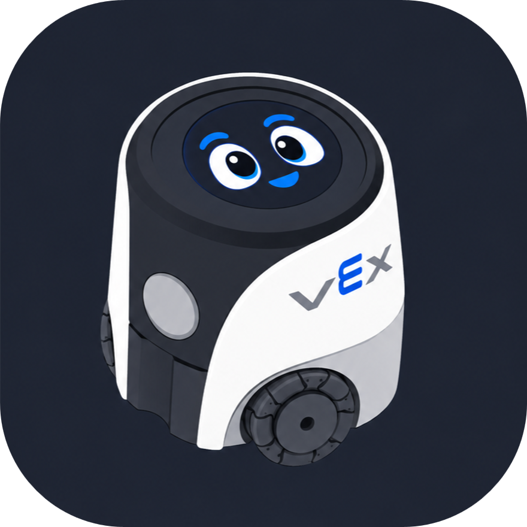

<div align="center">

<div style="display: flex; justify-content: center; align-items: center;">
  
  <picture>
    <source media="(prefers-color-scheme: dark)" srcset="images/wordmark-dark.svg">
    
  </picture>
</div>

<h4>浏览器直连 VEX AIM 机器人的局域网控制台</h4>

<div>
  <a href="https://vexaim.cc.cd/"></a>
  <a href="https://github.com/junco-liu/aim-plate/releases/latest"></a>
  <a href="https://github.com/junco-liu/aim-plate/stargazers"></a>
  
  
</div>

</div>

### ▸ [vexaim.cc.cd](https://vexaim.cc.cd/)
---

网页只是静态资源，WebSocket 由你的浏览器直接连到同一局域网内的机器人 —— 中间没有服务器，也没有你的数据。协议参照 [VEX-Robotics/AIM_Websocket_Library](https://github.com/VEX-Robotics/AIM_Websocket_Library) 的 Python 客户端重新实现。

> **请用 https 打开。** 明文 http 的公网页面会被 Chrome 直接拒绝访问局域网设备，且无法通过任何用户操作解除 —— 原因见 [托管方式决定能不能连上](#托管方式决定能不能连上)。

## 快速开始

1. 机器人与你的设备连入**同一局域网**（或直连机器人自身 AP，此时 IP 为 `192.168.4.1`）
2. 打开 **[vexaim.cc.cd](https://vexaim.cc.cd/)**，填机器人 IP，点「连接」
3. 浏览器询问「是否允许访问本地网络设备」时点**允许**
4. 拨动图注条上的「画面」开关看实时画面，用方向盘或键盘驾驶

未连接时页面上就印着这几步，不用回来查文档。

**键盘**：`WASD` / `↑↓←→` 平移 · `QE` 转向 · `空格` 急停。

## 功能

| 功能 | 介绍 |
|:---:|---|
| **驾驶** | 方向盘按住即走松开即停，键盘同步；左侧全高急停条，方向盘中心另有一个「停」 |
| **画面** | `ws_img` 推送的裸 JPEG 逐帧渲染，图注条上一个开关控制开停流 |
| **AI 视觉** | 画面上叠识别框（AprilTag 画四角，其余画外接框），按类别勾选过滤并实时计数，勾选与否直接下发到机器人开关检测。读数面板按面积排序，展开可看中心、方位角、旋转角、置信度 |
| **灯光** | 6 颗灯珠单独或整体设色 |
| **踢球** | 轻 / 中 / 重 |
| **表情** | 36 个内置表情的预览宫格，可选朝向，一键隐藏 |
| **机器人屏幕** | **画笔**在图版上直接画、抬笔即发；**图片**拖动取景、量化成 N 色再发 |
| **Python** | 浏览器里写、浏览器里跑，API 与官方 vex 库逐名对齐 |
| **主题与语言** | 亮 / 暗默认跟系统，中 / 英默认跟浏览器，选过一次就以你为准 |

> 计划中：MediaPipe 手势识别。

## Python

右栏切到「代码」页即是编辑器 + 控制台。API **与官方 [vex 库](https://github.com/VEX-Robotics/AIM_Websocket_Library) 逐名对齐** —— 方法名、参数顺序、单位、默认值都一样，官方文档和示例里的程序可以原样粘进来跑：

```python
robot = Robot()                   # 页面已经握着连接，Robot() 只是绑上去，写不写都行

robot.set_move_velocity(100)      # 100% == 200 mm/s
robot.move_for(300, 0)            # 走 300 mm，默认阻塞到走完
robot.turn_for(RIGHT, 90)
print(robot.get_x_position(), robot.inertial.get_heading())
robot.led.on((LED3, LED4), RED)   # 第一个参数可以是集合
robot.stop_all_movement()
```

跑在 **Pyodide v314.0.5（CPython 3.14.2）** 上，首次点开「代码」页才下载，约 6 MB。

`robot.move_for(...)` 不用写 `await` —— 同步阻塞靠 WebAssembly JSPI 实现，所以不需要
Web Worker 和 SharedArrayBuffer，也就不需要 GitHub Pages 给不了的 COOP/COEP 响应头。
代价是**只有 Chrome / Edge 能跑**（本来 LNA 也只放行它们）。

`drive` / `turn` 是持续命令，所以程序**正常结束、报错退出、手动停止**三条路都会补发急停 ——
程序结束等于机器人停下。纯计算死循环（`while True: pass`）打不断，中断只在 `await` 点生效。

<details>
<summary><b>完整 API 清单、编辑器按键、与官方源码的一处刻意不一致</b></summary>

<br>

**已实现**：`move_at` `move_for` `move_with_vectors` `turn` `turn_for` `turn_to`
`stop_all_movement` `spin_wheels` `set_move_velocity` `set_turn_velocity` ·
`get_x_position` `get_y_position` `set_xy_position` `get_battery_capacity`
`is_move_active` `is_turn_active` `is_stopped` · `has_any_barrel` 等四个 ·
`robot.inertial`（朝向 / 旋转 / 横滚俯仰偏航 / 加速度 / 陀螺速率 / 校准 / 碰撞灵敏度）·
`robot.screen`（文字、绘图、表情、触摸）· `robot.kicker` · `robot.led` ·
`robot.sound` · `robot.vision` · `Timer` · `wait`。

**未实现**：回调类（`screen.pressed` / `inertial.crashed` / `Timer.event`）—— 需要把
状态轮询接成事件源；`play_local_file` 和 `robot_send_audio` —— 需要 ws_audio 上传通道；
`show_file` —— 协议里没有上传通道，这条路本来就是死的；`color_description` /
`code_description`；`get_camera_image` —— 画面已经在图版上了。

`from vex import *` 和 `from vex.vex_globals import *` 在这里是空操作，留着只为官方示例能原样粘贴。

**灯光和视觉筛选的第一个参数都可以是集合**，跟文档一致：

```python
robot.led.on((LED3, LED4), RED)          # 元组，也可以是 [1, 6]
robot.led.on(3, True)                    # True 是白，None 是熄灭
robot.vision.get_data((ALL_TAGS, ALL_CARGO))    # 命中任一即算
```

**编辑器按键**：`Tab` 缩进、`Shift+Tab` 回退，两者都作用于选区触到的每一行；
`Tab` 被占用了，所以 **`Esc` 是离开输入框的出口**（不留这个口就是个键盘陷阱）。
输入 `robot.` 或任意两个字符会弹补全，`↑` `↓` 选、`Enter` 或 `Tab` 采纳、`Esc` 关掉。
**补全名单是运行时从 Python 拉的**：机器人 API 用 `dir()`，语言本身用
`keyword.kwlist` 和 `dir(builtins)` —— `for` `while` `def` `import` `print` `range` 都在里面，
共 417 项。都不是手写表，所以不可能和 `js/robot.js` 或解释器走歧。

括号和引号自动配对：打 `(` `[` `{` `"` `'` 自动补右半并把插入符放中间；右半已在那里时
再打一遍是跳过而不是重复；空对里退格两边一起删；选中文字后打左半会把选区包起来。
插入符后面紧贴着文字时不自动补（`fx` 前面打 `(` 不会得到 `()fx)`），词后的撇号也不补。

**视觉描述符**：`get_data` 的筛选参数是官方那套（`Tagdesc` / `AiObjdesc` / `ObjDesc` /
`Colordesc` / `Codedesc`），现成的挂在 `VisionObject` 和 `AiVision` 上：`ALL_VISION`
`ALL_TAGS` `ALL_COLORS` `ALL_CARGO` `TAG0`–`TAG37` `SPORTS_BALL` `BLUE_BARREL`
`ORANGE_BARREL` `AIM_ROBOT` `AiVision.ALL_AIOBJS`。返回值**按面积从大到小排序**，
所以 `largest_object()` 就是第 0 个。`AiVisionObject` 的属性与官方同名同义：
`type`（原始类型掩码整数，不是字符串）`id` `originX/Y` `centerX/Y` `width` `height`
`area` `angle` `rotation` `score` `exists` `bearing` `classname` `color` `tag.x` `tag.y`。

`light_set` 一条只带一个灯珠键，所以元组会逐个下发 —— 这是右栏灯光按钮已在真机上
跑通的形状，不去赌多键同报文能不能被固件接受。

**与官方源码唯一一处刻意不一致**：`robot.led.on(n, ...)` 的整数编号这里是 **1–6**，
和机器人上印的编号一致。官方源码写的是 `light{n+1}` 且判定区间是 `range(0, 6)`，于是
`on(1)` 亮的是第二颗、`on(6)` 会掉进 `else` 变成全部 —— 但它自己的 docstring 例子是
`robot.led.on(1, Color.BLUE)`，指的是第一颗。源码和文档矛盾，这里以文档为准。

</details>

## 桌面版 - [下载](https://github.com/junco-liu/aim-plate/releases/latest)

同一个页面，装成应用。三件事因此变得不一样：

- **不再弹局域网权限框** —— 窗口来源是 loopback，按 LNA 规则连 `ws://192.168.x.x` 无需授权，Firefox / Safari 的混合内容问题也一并绕开
- **运行时零联网** —— 36 张表情预览图打进了安装包，装完拔网线一切照常
- **代码页三个平台都能用** —— 网页版的 Python 靠 WebAssembly JSPI，而 mac 的 WKWebView 和 Linux 的 WebKitGTK 都没有；桌面版改把同一套 Python 交给一个**真的 CPython 进程**，写法完全一致。顺带，「停止」是杀进程，连 `while True: pass` 都打得断

| 平台 | 下载 | Python |
|---|---|---|
| **Windows** 10/11 x64 | `*_x64-setup.exe` | **已内置**，不用另装 |
| **macOS** Intel / Apple Silicon | `*_universal.dmg` | **要自己装**（12.3 起系统不再自带） |
| **Ubuntu 22.04+ / Debian 12+** | `*_amd64.deb` | deb 依赖 `python3`，apt 顺带装上 |


<details>
<summary><b>安装细节</b> —— 签名、依赖、中文字体</summary>

<br>

**Windows** — 需要 WebView2 运行时（Win11 预装，Win10 没有的话安装器会自动拉）。

**macOS** — Intel 和 Apple Silicon 同一个包。**没有签名**，首次打开要右键 →「打开」，或者：

```bash
xattr -dr com.apple.quarantine "/Applications/AIM Plate.app"
```

代码页需要自己装 Python 3：`brew install python3`，或者从 python.org 下载。没装的话代码页会显示「未找到 Python」并说明装好后重开即可，驾驶、画面、灯光都不受影响。没有内置是因为 dmg 是 universal，两个架构各要塞一份 23 MB 的解释器，代价对不上收益。

**Linux** — 包在 glibc 2.35 上构建，更老的系统会报 `GLIBC_2.xx not found`。用 `apt install` 装，它会顺带把 WebKitGTK 和中文字体一起装上：

```bash
sudo apt install ./AIM-Plate_*_amd64.deb
```

注意路径前面那个 `./`，少了它 apt 会去仓库里找同名包。**不要用 `dpkg -i`** —— dpkg 不解析依赖，缺库时它只会报错，还得再补一句 `sudo apt -f install`。如果坚持用 `dpkg -i` 或加了 `--no-install-recommends`，界面上的中文会显示成方框，补一句就好：

```bash
sudo apt install fonts-noto-cjk    # 或体积小得多的 fonts-wqy-zenhei
```

</details>

> **mac 上的代码页还没有人实机跑过。** 页面显示、机器人连接和驾驶控制在 mac 上实测通过；代码页这条路在 Windows 上验过完整往返，mac 上只保证编得出来。遇到问题请开 issue。

## 托管方式决定能不能连上

⚠️ Chrome 147（2026-04）起，**Local Network Access (LNA)** 把「网页访问局域网设备」纳入权限管控，并覆盖 WebSocket。判定依据是**地址空间**，不是 http/https：

| 页面来源 | 连 `ws://192.168.x.x` | 结果 |
|---|---|---|
| `http://localhost:8099` | loopback → local | ✅ 放行 |
| `http://192.168.x.x:8099` | local → local | ✅ 放行（同地址空间） |
| `file://` 本地打开 | — | ✅ 放行 |
| **`https://` 公网域名** | public → local | ⚠️ **弹权限框，点「允许」后可用** |
| **`http://` 公网域名** | public → local | ❌ **直接拒绝，不弹框，无解** |

最后一行是关键：LNA 权限**只授予安全上下文**，明文 HTTP 的公网页面永远拿不到。

混合内容不是问题：Chrome 对目标是 **RFC1918 字面 IP**（如 `192.168.137.236`）或 `.local` 名称的本地网络请求豁免混合内容检查。但若填的是解析到内网 IP 的**域名**而非字面 IP，混合内容会先行拦截且无出路 —— 所以**请始终填 IP**。

> Firefox / Safari 不实现 LNA，但它们**照常执行混合内容拦截**，所以在这两个浏览器里 https 页面连不上 `ws://`，需要走局域网托管或本地文件。

**结论**：Chrome / Edge 直接开 [vexaim.cc.cd](https://vexaim.cc.cd/) 点允许即可；其余浏览器或想零权限提示，就把本页放在局域网内提供服务，或用[桌面版](#桌面版)。

<details>
<summary><b>微信小程序也试过，连不上机器人 —— 点开看结论</b></summary>

<br>

上面那张表同样决定了小程序的命运。三条路各被一堵墙卡死：

| 通道 | 结果 | 卡在哪 |
|---|---|---|
| `wx.connectSocket` | `431` | 微信默认带的请求头约 671 字节（UA 独占 293、Referer 80），机器人的 HTTP 服务上限约 580 字节 —— 实测 530B 回 101、604B 回 431。`header` 选项只能加不能减，Referer 官方明说不给设 |
| `wx.createTCPSocket` | 连接被拒 | 微信禁止连 1024 以下端口，而机器人只开 80（端口扫过，其余一律 refused） |
| `<web-view>` 套壳本页 | 页面能开，连不上 | 公网 https 页连局域网需「访问本地网络设备」授权，嵌入式 WebView 没有权限 UI。iOS 更早一步就不行 —— web-view 就是 WKWebView，Safari 内核照常拦混合内容 |

机器人本身是清白的：不挑请求头、能同时接四条链路、握手一律规规矩矩回 `101`。

反过来，表里前三行（`file://`、`http://localhost`、`http://192.168.x.x`）都是**放行**，所以用系统 WebView 套壳本页做成 App 是成立的：页面从 `file://` 加载，既无混合内容问题也不需要 LNA 授权。

</details>


## 自己托管

不想装应用，也可以把仓库拉下来本地开 —— 没有构建步骤：

```bash
git clone https://github.com/junco-liu/aim-plate.git
cd aim-plate && python -m http.server 8099
```

局域网内其他设备（手机等）用本机的局域网 IP 访问，例如 `http://192.168.137.1:8099` —— 这条路径不受 LNA 限制，任何浏览器都能直接用。

<details>
<summary><b>协议要点</b> —— 四个 WebSocket、单位换算、表情与绘制两条路</summary>

<br>

四个独立 WebSocket，均无鉴权，端口 80：

| 端点 | 用途 |
|---|---|
| `ws://<ip>/ws_cmd` | 命令。JSON 序列化后以**二进制帧**发送，严格一问一答 |
| `ws://<ip>/ws_img` | 画面。发单字节 `0x01` 开流、`0x00` 关流，之后每条消息为一整张 JPEG |
| `ws://<ip>/ws_status` | 遥测。**轮询式** —— 发 `0x01` 才回一包 JSON。AI 视觉数据也在这一包里 |
| `ws://<ip>/ws_audio` | 音频上传（本控制台未使用） |

连接后第一条命令必须是 `{"cmd_id":"program_init"}`。

**报文里的单位是绝对值而非百分比**：移动 mm/s（上限 200），转向 deg/s（上限 180）。左转为负值。右栏滑块和 Python API 都按百分比读写，按官方的两个因子换算：100% 即 200 mm/s / 180 deg/s。

### 表情和绘制是两条路

表情是机器人内置的，`show_emoji {name, look}` **一条命令**就出图，和下面那条昂贵的绘制
路径完全不是一回事。但**表情盖在绘制内容之上** —— 表情还亮着的时候去画，命令发出去了
屏幕不动。所以画笔、图片、清屏在动手之前都会先自动补一条 `hide_emoji`，省得你以为没发出去。

预览图取自 `api.vex.com`，是本项目唯一的外部资源。**没有网就加载不出来**（连机器人自己的
热点时就是这种情况），此时宫格退回只显示名字，功能不受影响 —— 表情本身在机器人里，
不依赖这些图。

### 屏幕绘制为什么不能逐像素

圆形屏幕 r=120，可见像素 **45,239 个**。`lcd_draw_pixel` 的 JSON 里只有 `x,y`、没有颜色，
用的是当前笔色，所以多色图还得在换色前插 `lcd_set_pen_color` —— 最坏近 9 万条。
ws_cmd 是严格一问一答，这条路直接死。

实际走的编码：**量化 → 逐行行程编码 → 纵向合并同 x 同宽同色的行程 → 按颜色分组**。

`lcd_draw_rectangle` 是唯一自带 `r,g,b` 又能覆盖面积的原语，但它的**描边用当前笔色、
只有填充用内联色**，1px 高的矩形会被描边毁掉。按颜色分组之后笔色和填充色永远相同，
描边落在同色填充上、无害，而 `lcd_set_pen_color` 是每色一条不是每块一条。

行程还会按可见圆逐行裁剪，圆外一条都不发。实测三色横条图 **139 块矩形覆盖圆面积的
99.4%**；纯噪声图 38,001 条 —— 这就是为什么**没有做抖动**：抖动让每个像素都和邻居不同，
行程编码彻底失效，命令数直接回到逐像素量级。

发送严格串行，一条回一条。单条往返耗时**实测得到**（第一次发送时量出来存下来），
之后的预估用真实速率，不用估计的数字。

</details>

<details>
<summary><b>四个踩过的坑</b> —— 都是真机上撞出来的</summary>

<br>

**`ws_img` 必须用 `binaryType = 'arraybuffer'`。** 用 `'blob'` 时这条流会在帧解析阶段就报
`Invalid frame header` / `One or more reserved bits are on`，socket 当场死掉；只把 `binaryType`
换成 `arraybuffer`、收到后再自行 `new Blob([data])` 包一层，同一条流就完全正常。
两者只差这一个属性，已用只开 ws_img 的对照 socket 逐行比对确认。

**断链前要先发停流字节 `0x00`。** 官方 Python 客户端在退出路径里显式调 `stop_stream()`
（见 `aim.py` 的 `Robot` 退出处理）。直接掐 socket 会把机器人停在写了一半的帧上。
本页在 `closeAll()` 里补了这一步，并挂了 `pagehide` —— 关标签页是最常见的断开方式。

**socket 还开着，不等于机器人还在。** 按机器人电源键、或它那边的程序结束时，
socket 不一定会断，只有状态包里的标志位会变 —— 官方客户端就是靠这两位退出程序的
（`aim.py` 的 `check_power_button_flag` / `check_program_active_flag`）：bit 9 是电源键，
bit 10 是「有程序在跑」。本页和官方客户端一样先发 `program_init`，所以见过 bit 10 置起
之后又掉下去，就是机器人挂断了 —— 此时主动断开并说明原因，而不是继续显示「已连接」。

**`ws_status` 要收到回包才发下一次轮询。** 官方客户端是 send → 阻塞 receive → sleep，
任何时刻只有一个请求在飞。用固定 `setInterval` 打，机器人一慢请求就叠起来，
回包互相压着出来变成坏帧。本页改为从 `onmessage` 里排下一次轮询，另带 1s 看门狗。

</details>

<details>
<summary><b>本地开发与自检</b></summary>

<br>

代码拆成 `index.html` + `css/*.css` + `js/*.js`，用 `<link>` 和经典 `<script src>` 按顺序加载。
不用 ES modules 正是为了保住「下载后本地打开」这条路 —— `import` 在 `file://` 下会被 CORS 拦死。
没有构建步骤，改完刷新即可。

```bash
python -m http.server 8099
```

**内置自检**：在 URL 后加 `?selftest=1`，结果输出到页面日志与控制台。验证两件事 ——
重试不会在机器人上堆积 socket；`visionParse` 对状态包的解析（类型掩码、count 截断、
AprilTag 四角、方位角多项式）符合 `aim.py` 的口径；`encode()` 的行程合并生效、
矩形不越界也不落在可见圆之外、`lcd_set_pen_color` 每色只发一条。

</details>

<details>
<summary><b>界面是怎么想的</b> —— 图版与页边、两种颜色、不用卡片</summary>

<br>

浅色，取自实际使用现场（明亮教室 / 白天室内）而非品类习惯。视觉世界是「图版与页边」：
摄像头画面是一块带边框、下压实心图注条的**图版**，图注条在推流时由墨黑转为印刷蓝；
图注条既是图版的状态条也是它的控制条：左端是「画面 / 屏幕」切页，右端挂着当前内容的
开关（画面、AI 标注）—— 控件与它的状态指示是同一个物件，贴在它所控制的那块图版上，
手机端首屏即可见；机器人屏幕是同一块图版的第二种内容，不另占版面；
控制项按印刷分组排布，靠悬挂标题加通栏细线区分，**不使用卡片**；
悬挂标题同时是折叠开关（原生 `<details>`，不写 JS），默认只有「移动」展开，
其余手动展开 —— 右栏装了五组工具，全摊开就没法用了；把图版切到「屏幕」页会顺手展开
「屏幕」组，否则那一页没有工具可用；
左侧页边栏是全高**急停条**，方向盘中心另有一个「停」（急停冗余是有意的）。

颜色被严格隔离：黑墨 + 单一印刷蓝 `#17518C`，红色 `#B3261E` 只用于急停。
唯一的例外是画面上的 AI 标注：它叠在照片上而不是纸面上，自成一套配色（每类目标一个色相），
不参与页面的双色规则。

</details>

## 安全提示

机器人自身没有任何鉴权。**本页面对局域网内任何能访问到它的人开放机器人控制权。** 放在公网时若不希望被陌生人打开，请在前面加一层访问控制。

## License

[GPL-3.0](LICENSE) —— 可以自由使用、修改、分发，但**基于本项目的衍生作品必须同样以 GPL-3.0 开源**。
